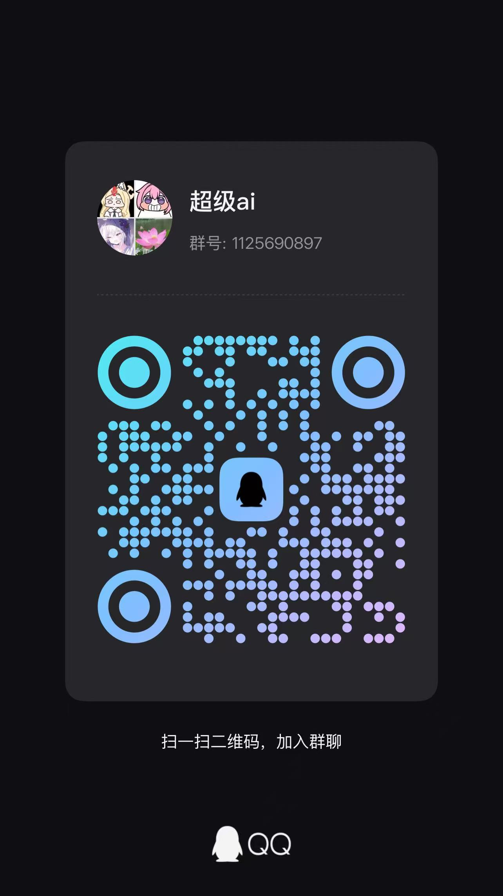

# Codex Live Wallpaper

[English](README.md) | **简体中文**

为 Codex 桌面应用添加动态壁纸，支持本地 Wallpaper Engine 视频及兼容的 Scene 项目，提供壁纸预览与切换、透明度与模糊调节、音频控制和启动恢复，让 AI 编程工作空间更具个性。

项目修改的是 **Codex 窗口背景**，不是 Windows 桌面壁纸；不需要安装 DSH 或 Cordis。

> **正式版：v1.0.0。** 支持 Windows 10 / Windows 11 x64，仅提供未签名的 EXE 安装包，不另外制作 ZIP 便携版。项目维护者已在另一台 Windows 10 电脑实测通过。这是独立社区项目，使用实验性的本机调试桥接。

[下载 v1.0.0](https://github.com/Yi-sama/Codex-Live-Wallpaper/releases/tag/v1.0.0) | [发布说明](docs/releases/v1.0.0.md) | [更新记录](CHANGELOG.md) | [反馈问题](https://github.com/Yi-sama/Codex-Live-Wallpaper/issues)

## 功能

- **视频与 Scene 动态背景：** 循环播放视频，使用 WebWallGL 渲染兼容的 `scene.pkg` 场景。
- **壁纸侧栏：** 右侧停靠、本地缩略图预览、标题或 ID 搜索，以及静态、视频、Scene、预览图分类筛选。
- **通用设置：** 独立齿轮页面调整面板材质、浅色/深色/跟随系统主题和字体。
- **外观调节：** 铺满或完整显示、缩放、位置、面板透明度、背景遮罩和模糊。
- **作者属性：** 调节 Scene 支持的开关、滑块、颜色、选项和文本，并按壁纸保存。
- **轮播列表：** 添加、排序、移除壁纸，切换上一张或下一张，设置轮播间隔及淡入淡出或直接切换。
- **声音控制：** 对有音轨的视频和兼容的 Scene 音效提供静音与音量调节。
- **可选 Scene 交互：** 被动转发鼠标事件，排除 Codex 输入框、菜单、弹窗及皮肤控件。
- **自动暂停与恢复：** Codex 不活跃时暂停渲染和声音；插件桥接启动后恢复保存的壁纸与参数。
- **视频预处理：** 缓存大视频转码结果，显示准备状态和实际传输进度。
- **可撤销：** 移除背景，不修改 Wallpaper Engine 原项目或 Codex 安装文件。
- **原生配色导出：** 生成 `codex-theme-v1` 配色主题字符串。

新选择的壁纸默认使用**背景模糊 3px、背景遮罩 10%、面板透明 20%**。手动调整和已保存的设置优先，不会被默认值覆盖。

## 壁纸兼容性

| 类型 | 当前行为 |
| --- | --- |
| Video | 格式受支持时使用内嵌或 Blob 视频播放；大视频可能先转码并缓存 |
| 打包 Scene (`scene.pkg`) | 使用 WebWallGL 渲染；不支持的效果或初始化失败时可能回退到预览图 |
| 未打包 Scene (`scene.json`) | 仅显示预览图 |
| Web / Application | 仅显示预览图，不运行其中的网页或可执行程序 |

WebWallGL 不是 Wallpaper Engine 官方运行时。部分场景特效、模型、字体或声音可能与原壁纸不同，也可能无法正确渲染。

大视频默认转为保留完整时长的 MP4，最高 2560x1440、30 FPS、约 10 Mbps；源视频有音轨时保留为 AAC，新转换不再复用旧的无声缓存。帧动画回退只是一段解码动画，不是完整原视频。

## 使用条件

- Windows 10 / Windows 11 x64，以及已经安装的官方 Codex 桌面应用。目前不提供 macOS、Linux 或 Windows ARM64 版本。
- EXE 内置 Node.js；源码安装才需要 Node.js 22 或更高版本，并确保命令行可执行 `node`。
- 支持插件命令的 Codex CLI，可用 `codex plugin --help` 检查。
- 已下载到本地的 Wallpaper Engine 项目文件。
- 启动器和转码使用 Windows PowerShell；仅帧动画回退需要 PowerShell 7 (`pwsh.exe`)。

Node 实现只使用内置模块，无需运行 `npm install`。

## Windows EXE 安装

安装、升级或卸载前，请先保存当前工作并完全退出 Codex，包括后台进程。仅关闭窗口不一定会退出程序，必要时可在任务管理器中确认。安装器会在替换文件前检查仍在运行的 Codex 或本安装目录的壁纸后台服务，提示退出后重试，不会自动结束或重启任何进程。

1. 运行 `CodexLiveWallpaper-Setup-1.0.0-x64.exe`。安装器检查 Codex 插件支持，为当前 Windows 用户安装并注册壁纸插件，不负责安装 Codex 或 Wallpaper Engine。
2. 通过开始菜单或桌面的 **Codex Live Wallpaper** 快捷方式打开。
3. 在壁纸库中选择本地 Wallpaper Engine 项目。之后通过配套快捷方式启动，会恢复保存的背景；也可以继续通过 Codex 工具列出并应用壁纸。

安装包只包含插件，不包含壁纸素材。首次通过启动器打开时显示壁纸库，不自动应用壁纸；选择本地项目后才显示调整控件。

发布附件为 `CodexLiveWallpaper-Setup-1.0.0-x64.exe` 及对应的 `.sha256` 文件。安装前可计算 EXE 的 SHA-256，与校验文件中的值比较：

```powershell
Get-FileHash .\CodexLiveWallpaper-Setup-1.0.0-x64.exe -Algorithm SHA256
```

默认程序目录为 `%LOCALAPPDATA%\Programs\CodexLiveWallpaper`，壁纸设置和缓存放在 `%LOCALAPPDATA%\CodexLiveWallpaper\data`。首次安装支持显式设置的 `CODEX_HOME`、`CODEX_SKIN_DATA_DIR` 环境变量；重复安装保留已经记录的配置和数据目录。安装器使用内置 Node，并自动生成匹配的启动器及 MCP 路径，无需手动修改 JSON。

双击安装目录内的 `unins000.exe` 即可卸载；开始菜单也有 **Uninstall Codex Live Wallpaper** 入口，Windows“已安装的应用”使用同一卸载器。卸载会移除此版本的程序文件、插件及 marketplace 注册，保留壁纸设置、缓存和 Codex 登录文件。不要直接删除程序目录来代替卸载。

如果相同壁纸插件已经从其他 marketplace 安装，安装器会停止，而不是直接覆盖。已有定制安装应先保留当前启动方式和设置，再安排迁移；本安装包不自动迁移这些旧安装。

安装包尚未签名，Windows 可能显示安全提示。请只从本仓库下载并核对 SHA-256，不要为了安装关闭安全软件。

安装器不会直接运行受保护的 Store CLI，不修改 WindowsApps 权限、不启用开发模式，也不要求管理员模式。Store 应用使用包身份启动，非 Store 应用直接启动。经过校验的私有 CLI 副本与壁纸数据分开保留，避免删除仍被占用的可执行文件。

启动器最多等待 90 秒，直到发现准确的 Codex 主页面；进程退出时立即停止等待。这是启动兼容处理，不代表原故障根因已被确认。源码启动器支持 `-StartupTimeoutSeconds`，范围为 1 至 300 秒。

安装诊断通常保留在 `%LOCALAPPDATA%\CodexLiveWallpaper\logs`，启动诊断位于壁纸数据目录的 `launcher.log`。`scripts/diagnose-launcher.cmd` 可检查已运行实例的两个本地地址，并在脚本旁生成报告；不会重启 Codex 或读取登录文件。分享日志前请检查其中的个人路径。

## 已测试与兼容性说明

- 项目维护者已在另一台 Windows 10 电脑实测通过，并确认此前反馈的使用流程目前正常。
- 136 项自动化回归测试全部通过，覆盖侧栏与裁剪映射、预览恢复、设置保存、保留音轨的转码、版本信息、安装进程检查及启动器图标。
- 1.0.0 验证期间，隔离环境中的 Windows 安装、重复安装与卸载检查通过，包括壁纸设置、缓存及模拟登录文件的保留检查。
- 实测通过不代表所有 Scene 特效、硬件环境或长时间运行情况都兼容。不支持的 Scene 可能回退到预览图或显示可用于排查的错误提示；Web / Application 项目仍仅显示预览。
- Codex 更新可能影响实验性桥接；已有定制插件安装不会自动迁移。

## 源码安装

以下是面向开发者的手动源码安装步骤，需要配置路径。已有定制安装请保留原来的 Codex 配置、marketplace、存储路径及启动方式。

### 1. 放置源码

下载当前版本源码，将插件根目录放进一个工作目录，例如：

```text
D:\CodexLiveWallpaper\
  .agents\
    plugins\
      marketplace.json
  plugins\
    dsh-plugin-wallpaper-engine-codex\
      .codex-plugin\
      .mcp.json
      package.json
      scripts\
      src\
```

公开名称使用 **Codex Live Wallpaper**。内部插件 ID 暂时保留 `dsh-plugin-wallpaper-engine-codex`，以兼容现有安装。

### 2. 统一数据目录

公开源码的 `.mcp.json` 不包含本机数据路径。默认情况下，源码 MCP 服务和启动器都使用 `%LOCALAPPDATA%\CodexWallpaperEngineSkin`。

如果自定义源码数据目录，在 MCP 环境中设置 `CODEX_SKIN_DATA_DIR`，并通过启动器的 `-DataDir` 参数传入相同路径。JSON 中的反斜杠需要写成双反斜杠。下方命令使用自定义目录示例 `D:\CodexLiveWallpaper\data`。

`.mcp.json` 中的 `CODEX_SKIN_CDP_PORT` 保持为 `"0"`，由启动器自动选择可用的本机端口并发布实际地址。

EXE 安装会自动配置两端。使用自定义 Codex 配置目录时，还需要向启动器传入对应的 `-CodexHome` 参数。

### 3. 注册本地 marketplace

在工作目录下创建 `.agents/plugins/marketplace.json`：

```json
{
  "name": "codex-live-wallpaper",
  "interface": {
    "displayName": "Codex Live Wallpaper"
  },
  "plugins": [
    {
      "name": "dsh-plugin-wallpaper-engine-codex",
      "source": {
        "source": "local",
        "path": "./plugins/dsh-plugin-wallpaper-engine-codex"
      },
      "policy": {
        "installation": "AVAILABLE",
        "authentication": "ON_INSTALL"
      },
      "category": "Productivity"
    }
  ]
}
```

然后运行：

```powershell
codex plugin marketplace add "D:\CodexLiveWallpaper"
codex plugin add dsh-plugin-wallpaper-engine-codex@codex-live-wallpaper
```

插件目录和 marketplace 格式参考 [OpenAI 官方插件文档](https://developers.openai.com/plugins/build/plugins)。

### 4. 检查并启动

先检查启动环境，此命令不会启动或关闭 Codex：

```powershell
powershell.exe -NoProfile -ExecutionPolicy Bypass -File "D:\CodexLiveWallpaper\plugins\dsh-plugin-wallpaper-engine-codex\scripts\launch-codex-with-skin.ps1" -DataDir "D:\CodexLiveWallpaper\data" -ValidateOnly
```

完成或保存正在进行的任务，自行关闭所有 Codex 窗口，再运行：

```powershell
powershell.exe -NoProfile -ExecutionPolicy Bypass -File "D:\CodexLiveWallpaper\plugins\dsh-plugin-wallpaper-engine-codex\scripts\launch-codex-with-skin.ps1" -DataDir "D:\CodexLiveWallpaper\data"
```

如果 Codex 仍在运行，启动器会先询问是否重启；拒绝不会关闭现有窗口。Scene 权限初始化包含一次启动阶段的页面重载，不要对正在处理任务的窗口单独运行初始化脚本。

## 使用

在新建的 Codex 对话中，可以这样提出请求：

- “列出可以作为 Codex 背景的本地 Wallpaper Engine 项目。”
- “应用这张壁纸，把面板调透明一点。”
- “开启壁纸声音，音量设为 30%。”
- “移除 Codex 壁纸。”
- “生成一套 Codex 原生暗色配色主题。”

应用壁纸后，侧栏提供**外观**、**壁纸库**、**轮播**和壁纸**设置**页签；独立齿轮页面提供通用界面设置。以后通过配套启动器打开 Codex，插件桥接启动后会恢复保存的选择与参数。直接使用普通 Codex 图标不会启用壁纸调试桥接。

如果无法发现项目，可在 MCP 进程环境中设置 `WALLPAPER_ENGINE_HOME` 指向 Wallpaper Engine 目录，或设置 `WALLPAPER_ENGINE_STEAM_ROOT` 指向 Steam 根目录。

## 数据与移除

配置的数据目录保存 `state.json`、`debug-endpoint.json`、启动日志及 `transcoded/` 缓存，不会替换用户的 Codex 配置或登录信息。

需要恢复普通外观时，让 Codex 移除壁纸；`codex_skin_remove` 会撤销注入层并清除保存的壁纸选择。之后可以使用普通 Codex 启动方式。

如果使用了上述示例 marketplace，可这样卸载：

```powershell
codex plugin remove dsh-plugin-wallpaper-engine-codex@codex-live-wallpaper
```

该命令移除插件缓存，不删除 Wallpaper Engine 项目或单独存放的皮肤数据目录。
EXE 安装请运行程序目录内的 `unins000.exe`，或通过 Windows“已安装的应用”卸载，以同时清理安装文件及 marketplace 注册。

## 原理与限制

启动器为已安装的 Codex 开启本机 Chrome DevTools 调试入口，MCP 桥接读取已发现的 Wallpaper Engine 项目，只向 URL 完全等于 `app://-/index.html` 的 Codex 主页面注入背景。Scene 在独立来源的本机 iframe 中运行，并启用跨站进程隔离。

- 不修改或替换 Codex 安装文件。
- 只读 Wallpaper Engine 项目；应用接口接受已发现的项目 ID，不接受任意媒体路径。
- 不向浏览器标签、登录页面或其他调试目标注入背景。
- 调试入口可以控制 Codex 渲染页面，应仅限本机使用，不要开放或转发到网络。
- 动态背景依赖实验性的调试集成，不是官方壁纸扩展接口。Codex 应用更新后可能需要适配；单独切换 AI 模型不代表必须重新配置皮肤。

## 开发

在插件根目录运行：

```powershell
npm run verify
```

Windows CI 使用 Node.js 24.14.0 执行此命令。回归测试使用隔离夹具，不要求安装 Codex 或 Wallpaper Engine，也不会重启真实应用。下方单独的 EXE 安装流程检查需要已经安装 Codex。

在插件根目录构建 Windows 安装包：

```powershell
powershell.exe -NoProfile -ExecutionPolicy Bypass -File ".\scripts\build-windows-installer.ps1"
```

构建脚本下载并校验固定版本的 Node.js 24.14.0 和 Inno Setup 7.1.0，以便携模式解压编译器，输出 `outputs/windows/CodexLiveWallpaper-Setup-1.0.0-x64.exe` 及 SHA-256 校验文件。最终用户无需安装编译器、Node 或解压工具。

用隔离配置和数据目录验证安装包：

```powershell
powershell.exe -NoProfile -ExecutionPolicy Bypass -File ".\packaging\windows\verify-installer.ps1" -InstallerPath ".\outputs\windows\CodexLiveWallpaper-Setup-1.0.0-x64.exe" -WorkRoot ".\work\windows-installer\verification"
```

该检查会真实执行静默安装、重复安装和卸载，但不会启动 Codex。当前 Windows 用户已经注册此 EXE 版本时，检查会拒绝运行。

| 路径 | 用途 |
| --- | --- |
| `.codex-plugin/plugin.json` | 插件清单和当前内部标识 |
| `.mcp.json` | 本地 MCP 服务及环境配置 |
| `scripts/mcp-server.mjs` | MCP 工具服务 |
| `scripts/launch-codex-with-skin.ps1` | 启用皮肤的 Codex 启动器 |
| `scripts/prepare-codex-scene.mjs` | 启动阶段的 Scene 权限初始化 |
| `scripts/build-windows-installer.ps1` | 固定版本及校验和的 Windows EXE 构建 |
| `packaging/windows/` | 安装定义、注册、安装后的启动器及隔离安装检查 |
| `src/codex-skin.mjs` | 皮肤桥接、播放、保存与恢复 |
| `src/skin-controls.mjs` | 壁纸库、轮播和被动 Scene 交互 |
| `src/scene-runtime.mjs` | 本机 Scene 资源服务 |
| `src/webwallgl/assets/` | 第三方渲染资源 |
| `skills/wallpaper-engine/` | Codex 工具使用流程 |
| `test/` | Node 回归测试 |
| `docs/RELEASING.md` | 发布检查和仅提供 EXE 的发布流程 |

源码和 EXE 继续保留内部插件 ID，以兼容已有安装；公开元数据指向本仓库。EXE 自动配置独立本地 marketplace，不改动源码 `.mcp.json` 或已有定制安装。个人项目日志、凭据、缓存、构建输出和壁纸素材不属于公开源码内容。

## 问题反馈与交流群

有问题、建议或兼容性反馈，可以 [提交 Issue](https://github.com/Yi-sama/Codex-Live-Wallpaper/issues/new)，或扫码加入 QQ 群 **超级ai**，群号 **1125690897**。



请勿在 Issue 或群内发送 Codex 登录文件、API 密钥、访问令牌或未经检查的完整日志。

## 来源与许可

当前版本基于 [JonathandNidhog/dsh-plugin-wallpaper-engine-codex](https://github.com/JonathandNidhog/dsh-plugin-wallpaper-engine-codex) 扩展，原项目由 DSH Wallpaper Engine 集成演进而来。Scene 路径还参考了 [elysia395/dsh-wallpaper-engine](https://github.com/elysia395/dsh-wallpaper-engine)。运行方式和第三方声明见 [NOTICE.md](NOTICE.md)。

主要插件代码使用 [MIT 许可证](LICENSE)，保留原版权及许可声明。第三方代码继续遵循各自的授权，包括 Scene 渲染包中保留的 MPL-2.0 声明，不能只按主项目的 MIT 标签处理。
EXE 的 `runtime/` 目录包含 Node.js 许可及 MPL-2.0 正文。当前构建编译器未使用商业授权，维护者应按自己的使用方式核对 [Inno Setup 授权说明](https://jrsoftware.org/isorder.php)。

项目不附带壁纸素材。Wallpaper Engine 项目以及 Codex、Steam、Wallpaper Engine 名称属于各自权利人。本项目是独立社区项目，并非 OpenAI 或 Wallpaper Engine 官方产品。
